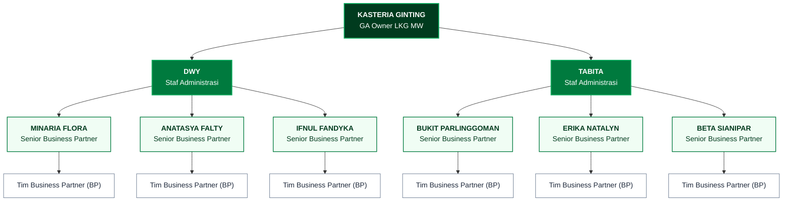
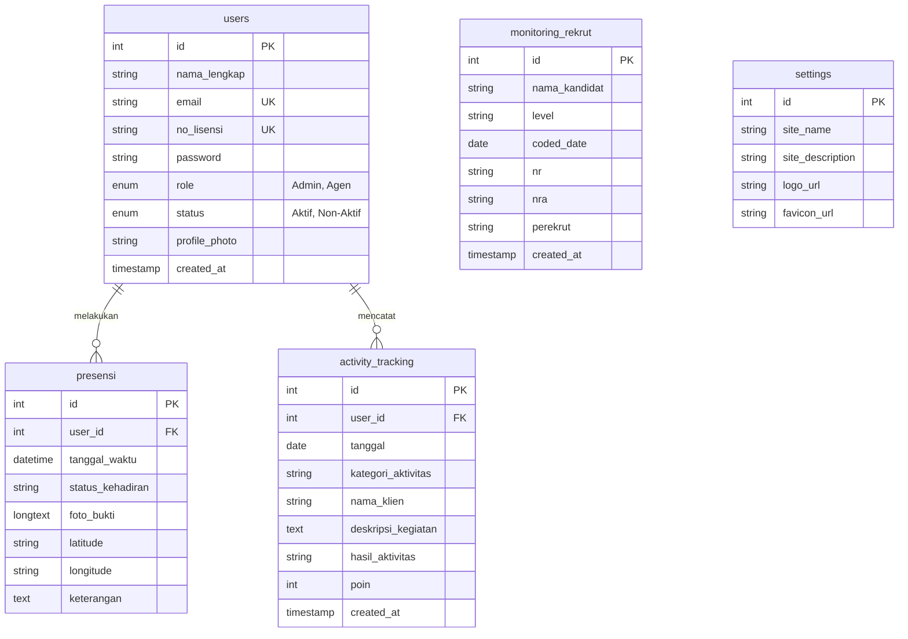

# 🏢 Sistem Informasi Manajemen Presensi & Monitoring Aktivitas Harian Agen (Activity Tracking) Berbasis Web

[](https://www.php.net/)
[](https://www.mysql.com/)
[](https://getbootstrap.com/)
[](https://leafletjs.com/)
[](LICENSE)

---

## 📌 Tentang Sistem

**Sistem Informasi Manajemen Presensi dan Monitoring Aktivitas Harian Agen (*Activity Tracking*) Berbasis Web** adalah platform terintegrasi yang dirancang khusus untuk memodernisasi dan mengotomatisasi tata kelola operasional pada **General Agency (GA) Office Manulife LKG MW (Medan)**.

Sebelum sistem ini dibangun, proses presensi kehadiran dan evaluasi aktivitas mingguan agen masih dilakukan menggunakan formulir kertas manual (*paper-based*). Hal tersebut menimbulkan berbagai kendala, seperti lamanya rekapitulasi data poin aktivitas, risiko manipulasi kehadiran, hilangnya lembar fisik, serta keterlambatan dalam menyajikan data kinerja kepada pimpinan agensi (*GA Owner*) untuk sesi evaluasi dan pembinaan (*coaching*).

Sistem ini hadir sebagai solusi digital terpusat yang dilengkapi verifikasi kehadiran berbasis **GPS Geolocation & Foto Bukti Kamera (*Selfie*)**, pemantauan target kinerja berbasis **Standar Formula 20 Poin Manulife**, serta modul **Monitoring Rekrutmen Agen Baru**.

---

## 👥 Profil Proyek & Instansi

* **Instansi Mitra:** GA Office Manulife LKG MW (Medan)
* **Pimpinan Agensi (GA Owner):** Kasteria Ginting
* **Staf Administrasi Agensi:** Dwy & Tabita
* **Penulis / Pengembang:** Erdaniwati
* **Institusi Akademik:** Institut Teknologi dan Bisnis Indonesia (ITBI Medan) / Yayasan Pendidikan Poliprofesi
* **Kategori Karya:** Laporan Praktik Kerja Lapangan (PKL) / Proyek Sistem Informasi

---

## 🌟 Fitur Utama

### 1. 🔐 Autentikasi & Kontrol Akses Berbasis Role (RBAC)
* **Multi-Role User:**
  * **Admin (Staf Administrasi & GA Owner):** Akses menyeluruh ke audit presensi seluruh agen, audit aktivitas seluruh tim, kelola kandidat rekrutmen, manajemen akun agen, dan pengaturan portal agensi.
  * **Agen Pemasar:** Akses mandiri untuk check-in presensi harian, mencatat aktivitas harian nasabah, memantau perolehan poin mingguan, melihat riwayat rekrutmen agensi, serta memperbarui profil pribadi.
* **Fleksibilitas Login:** Pengguna dapat masuk menggunakan **Nomor Lisensi AAJI** atau **Alamat Email**.
* **Proteksi Status Akun:** Hanya akun berstatus `Aktif` yang diizinkan masuk. Apabila akun diubah menjadi `Non-Aktif` oleh Admin, sesi aktif pengguna langsung dihentikan secara otomatis demi menjaga privasi dan keamanan sistem.

### 2. 📍 Presensi Geolocation & Foto Bukti Webcam (Selfie)
* **Deteksi Koordinat GPS Otomatis:** Mengambil data koordinat garis lintang (*Latitude*) dan garis bujur (*Longitude*) perangkat secara akurat (*HTML5 Geolocation API*).
* **Peta Interaktif (Leaflet.js & OpenStreetMap):** Menampilkan posisi titik lokasi check-in secara visual dengan penanda (*marker*) interaktif.
* **Verifikasi Wajah / Foto Bukti:** Pengambilan foto selfie langsung melalui kamera/webcam (*HTML5 MediaDevices*) yang tersimpan aman dalam format base64.
* **Opsi Status Kehadiran Fleksibel:**
  * `Hadir Kantor` (Piket / Training / Pertemuan Agensi)
  * `Hadir Lapangan` (Kunjungan Klien / Prospek)
  * `WFH / Remote` (Kerja Jarak Jauh)
  * `Izin / Sakit`
* **Audit & Filter Admin:** Staf administrasi dapat menyaring riwayat presensi berdasarkan nama agen dan tanggal tertentu.

### 3. 🎯 Activity Tracking Berstandar Formula 20 Poin Manulife
* **Standar Pembobotan Poin Resmi:**
  * 📞 **Tele-polling:** 1 Poin
  * 🤝 **Janji Temu:** 3 Poin
  * 📊 **Presentasi Produk / Proposal:** 4 Poin
  * 🏆 **Closing Polis:** 5 Poin
* **Target Mingguan 20 Poin:** Target baku bagi setiap agen dalam menjaga konsistensi aktivitas harian.
* **Progress Bar Dinamis Real-Time:** Menghitung akumulasi poin dari 7 hari terakhir beserta persentase pemenuhan target secara visual.
* **Pencatatan Komprehensif:** Mendokumentasikan tanggal aktivitas, kategori, nama prospek/nasabah, deskripsi interaksi, dan hasil kegiatan.
* **Audit Aktivitas Tim:** Admin dapat meninjau seluruh pergerakan prospek dari seluruh agen agensi.

### 4. 📋 Monitoring Rekrutmen Agen Baru
* **Pelacakan Pipeline Rekrutmen:** Memantau kandidat dari pendaftaran awal hingga berlisensi.
* **Atribut Data Lengkap:**
  * Nama Kandidat
  * Level Kualifikasi (misal: *Business Partner* / *Senior Business Partner*)
  * *Coded Date* (Tanggal resmi pengkodean kandidat)
  * Status NR (*New Recruit*)
  * Status NRA (*New Recruit Active* / Lisensi AAJI)
  * Nama Agen Perekrut
* **Pencarian Multikriteria:** Filter berdasarkan nama kandidat, hari, bulan, tahun *coded*, dan level.
* **Format Cetak Laporan Resmi:** Dilengkapi tata letak khusus cetak (*print-friendly*) disertai lembar tanda tangan Staf Administrasi Agensi.

### 5. 👥 Manajemen Akun Agen (Kelola Agen - Admin Only)
* Pendaftaran akun agen baru dengan validasi keunikan lisensi AAJI dan email.
* Pengaturan status akun: `Aktif` atau `Non-Aktif`.
* Fitur **Reset Kata Sandi Agen** secara instan jika agen mengalami lupa kata sandi.
* Hapus akun agen yang sudah tidak terafiliasi.

### 6. ⚙️ Pengaturan Portal Agensi (Settings - Admin Only)
* Kustomisasi nama agensi (default: `GA LKG MW`) dan deskripsi kantor (default: `Manulife Medan`).
* Fitur unggah logo resmi agensi dan favicon browser secara dinamis dengan direktori penyimpanan otomatis di `uploads/`.

### 7. 👤 Pengaturan Profil Pengguna
* Pembaruan informasi nama lengkap dan email.
* Unggah foto profil pribadi yang terintegrasi di navbar dan dashboard.
* Ganti kata sandi mandiri dengan fitur *toggle show/hide password*.

---

## 📊 Struktur Organisasi Agensi & Alur Sistem

Berikut adalah struktur hierarki kepemimpinan dan pembagian tim pada **GA Office Manulife LKG MW**:



---

## 🛠️ Arsitektur & Teknologi

| Komponen | Teknologi | Deskripsi |
| :--- | :--- | :--- |
| **Backend Engine** | PHP 7.4 - 8.3+ | PHP Native / Prosedural dengan ekstensi `mysqli` |
| **Database Server** | MySQL 5.7+ / MariaDB | Penyimpanan relasional data pengguna, absensi, dan aktivitas |
| **Frontend Framework** | Bootstrap 5.3 | Kerangka UI responsif untuk desktop, tablet, dan smartphone |
| **Styling & Icons** | Custom CSS3 + Font Awesome 6 | Palet warna korporat Manulife Green (`#00a758`, `#007a3e`, `#003b1e`) |
| **Pemetaan Interaktif**| Leaflet.js 1.9.4 & OpenStreetMap | Visualisasi titik koordinat presensi agen di lapangan |
| **Kamera & Media** | HTML5 MediaDevices & Canvas API | Pengambilan foto bukti selfie secara real-time di browser |
| **Tipografi** | Google Fonts (Poppins) | Tampilan modern, bersih, dan mudah dibaca |

---

## 📁 Struktur Direktori Proyek

```text
manulife-lkg-mw/
├── config/
│   └── database.php                # Parameter konfigurasi koneksi MySQL
├── includes/
│   ├── header.php                  # Header global, navigasi navbar, sidebar, CSS
│   └── footer.php                  # Footer global, scripts bootstrap & modal
├── pages/
│   ├── dashboard.php               # Dashboard metrik & statistik (Admin & Agen)
│   ├── presensi.php                # Modul presensi selfie webcam + GPS Leaflet
│   ├── activity.php                # Modul activity tracking formula 20 poin
│   ├── rekrut.php                  # Modul monitoring rekrutmen agen baru
│   ├── kelola_agen.php             # Modul manajemen akun agen & reset sandi (Admin)
│   ├── settings.php                # Modul pengaturan nama agensi & logo/favicon (Admin)
│   └── profile.php                 # Modul pembaruan profil & kata sandi pribadi
├── uploads/                        # Folder penyimpanan file unggahan
│   ├── profiles/                   # Subfolder foto profil pengguna
│   └── [timestamp_logo/fav.*]     # Berkas logo dan favicon agensi
├── agency_db.sql                   # Skrip DDL database MySQL & data benih (seed data)
├── index.php                       # Titik masuk utama aplikasi (Main Controller & Routing)
├── login.php                       # Halaman login portal & verifikasi kredensial
├── logout.php                      # Proses terminasi sesi login
├── alurnya.md                      # Dokumentasi struktur bagan organisasi
├── diagram_bab4_hitam_putih.md     # Kumpulan diagram UML Bab IV (Standar Laporan PKL)
└── README.md                       # Dokumentasi lengkap sistem
```

---

## ⚙️ Panduan Instalasi & Menjalankan Sistem

### 1. Kebutuhan Sistem (Prerequisites)
Pastikan komputer/laptop telah terpasang:
* Paket Server Lokal: **XAMPP** (versi PHP 7.4, 8.0, 8.1, atau 8.2+) atau Laragon.
* Web Browser modern: Google Chrome, Mozilla Firefox, atau Microsoft Edge (dengan izin akses kamera dan lokasi aktif).

### 2. Langkah Instalasi

#### Langkah A: Salin Proyek ke Direktori Server
1. Buka direktori web server Anda:
   * **XAMPP di Windows:** `C:\xampp\htdocs\`
2. Salin atau letakkan folder proyek ini dengan nama:
   `manulife-lkg-mw`
   sehingga jalurnya menjadi: `C:\xampp\htdocs\manulife-lkg-mw`

#### Langkah B: Buat & Impor Database
1. Buka browser dan buka **phpMyAdmin**:
   ```text
   http://localhost/phpmyadmin/
   ```
2. Buat database baru dengan nama:
   ```sql
   agency_db
   ```
   *(Pilih collation: `utf8mb4_unicode_ci`)*
3. Pilih database `agency_db`, lalu klik menu **Import**.
4. Klik **Choose File** dan pilih file [`agency_db.sql`](agency_db.sql) yang terletak di direktori root proyek ini.
5. Klik tombol **Import / Kirim** di bagian bawah hingga seluruh tabel berhasil dibuat.

#### Langkah C: Konfigurasi Koneksi Database
Periksa file [`config/database.php`](config/database.php). Secara bawaan (default XAMPP):
```php
<?php
$host = "localhost";
$user = "root";
$pass = "";
$db   = "agency_db";

$conn = mysqli_connect($host, $user, $pass, $db);

if (!$conn) {
    die("Koneksi Database Gagal: " . mysqli_connect_error());
}
?>
```
*Sesuaikan variabel `$user` dan `$pass` jika MySQL Anda menggunakan kata sandi khusus.*

#### Langkah D: Jalankan Aplikasi
1. Buka aplikasi **XAMPP Control Panel**, lalu pastikan modul **Apache** dan **MySQL** dalam status **Running (Start)**.
2. Buka browser dan kunjungi alamat:
   ```text
   http://localhost/manulife-lkg-mw/
   ```
3. Anda akan diarahkan ke halaman login portal.

---

## 🔑 Kredensial Pengguna Bawaan (Default Accounts)

Database [`agency_db.sql`](agency_db.sql) telah dilengkapi akun demo siap pakai:

| Role | Nama Pengguna | Lisensi AAJI | Alamat Email | Kata Sandi | Status |
| :--- | :--- | :--- | :--- | :--- | :--- |
| **Admin** | Staf Administrasi (DWY / TABITA) | `ADMIN001` | `admin@manulife.co.id` | `admin123` | **Aktif** |
| **Agen** | Minaria Flora | `AAJI-0012345` | `minaria@manulife.co.id` | `agen123` | **Aktif** |
| **Agen** | Anatasya Falty | `AAJI-0012346` | `anatasya@manulife.co.id` | `agen123` | **Aktif** |

> **Catatan Penggunaan Login:** Pengguna dapat memasukkan **Nomor Lisensi AAJI** atau **Email** pada kolom *Identifier* di form login.

---

## 🗄️ Skema & Kamus Basis Data

Basis data `agency_db` terdiri dari 5 entitas tabel utama:



### Penjelasan Tabel:
1. **`users`**: Menyimpan kredensial identitas pengguna, hak akses role (`Admin` / `Agen`), nomor registrasi lisensi resmi AAJI, dan status akun (`Aktif` / `Non-Aktif`).
2. **`presensi`**: Menyimpan catatan log absensi, stempel tanggal-waktu, koordinat GPS (*latitude/longitude*), foto bukti snapshot kamera (base64 data), dan alasan/keterangan.
3. **`activity_tracking`**: Menyimpan rekaman aktivitas prospek agen di lapangan dengan perhitungan poin otomatis (*Tele-polling: 1, Janji Temu: 3, Presentasi: 4, Closing: 5*).
4. **`monitoring_rekrut`**: Mengelola data calon kandidat agen baru agensi, status kode (*Coded Date*), lisensi baru (NR & NRA), dan pihak perekrut.
5. **`settings`**: Menyimpan identitas agensi dinamis seperti nama portal, deskripsi kantor, logo agensi, dan ikon favicon tab browser.

---

## 💡 Petunjuk Penggunaan Fitur Kamera & Lokasi

Untuk memastikan fitur presensi berjalan optimal:
1. **Izin Kamera (*Camera Permission*):** Saat pertama kali membuka halaman `Presensi`, klik tombol **Izinkan / Allow** pada kotak dialog izin akses kamera browser.
2. **Izin Lokasi (*Location Permission*):** Browser akan meminta izin akses lokasi (*Geolocation*). Pastikan GPS pada perangkat Anda aktif dan klik **Izinkan / Allow**.
3. **Penyimpanan Lokal (Localhost):** Fitur kamera dan geolocation diizinkan secara penuh oleh standar browser modern pada domain `localhost` atau domain berprotokol `https://`.

---

## 📄 Hak Cipta & Lisensi

Sistem ini dikembangkan oleh **Erdaniwati** sebagai bagian dari pelaksanaan Praktik Kerja Lapangan (PKL) Program Studi Sistem Informasi / Manajemen Informatika pada **Institut Teknologi dan Bisnis Indonesia (ITBI Medan)** yang dilaksanakan di **General Agency (GA) Office Manulife LKG MW**.

Didedikasikan untuk kemajuan digitalisasi tata kelola operasional dan kemudahan monitoring kinerja para agen asuransi Manulife Indonesia.
