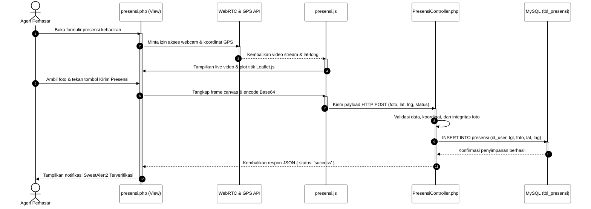
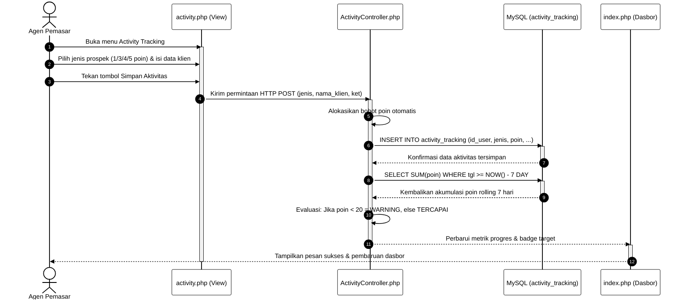
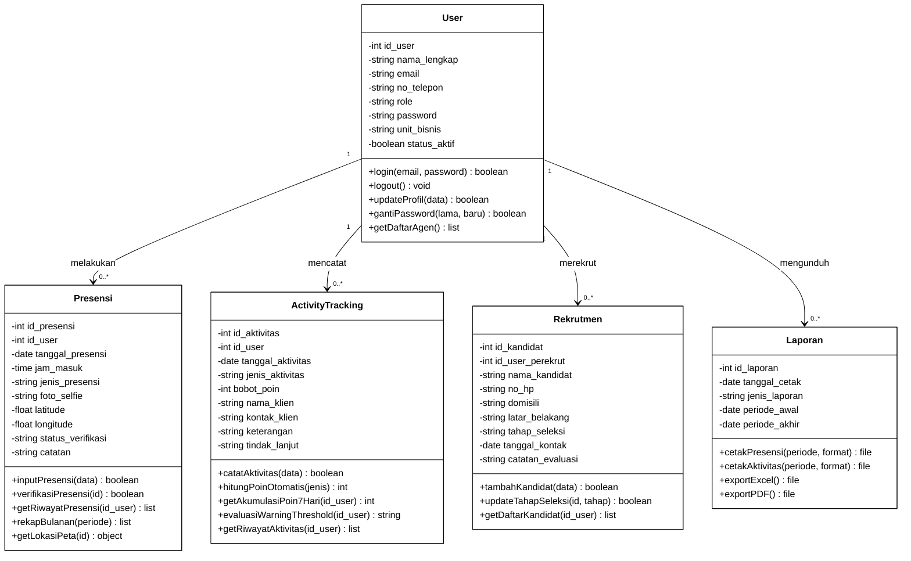
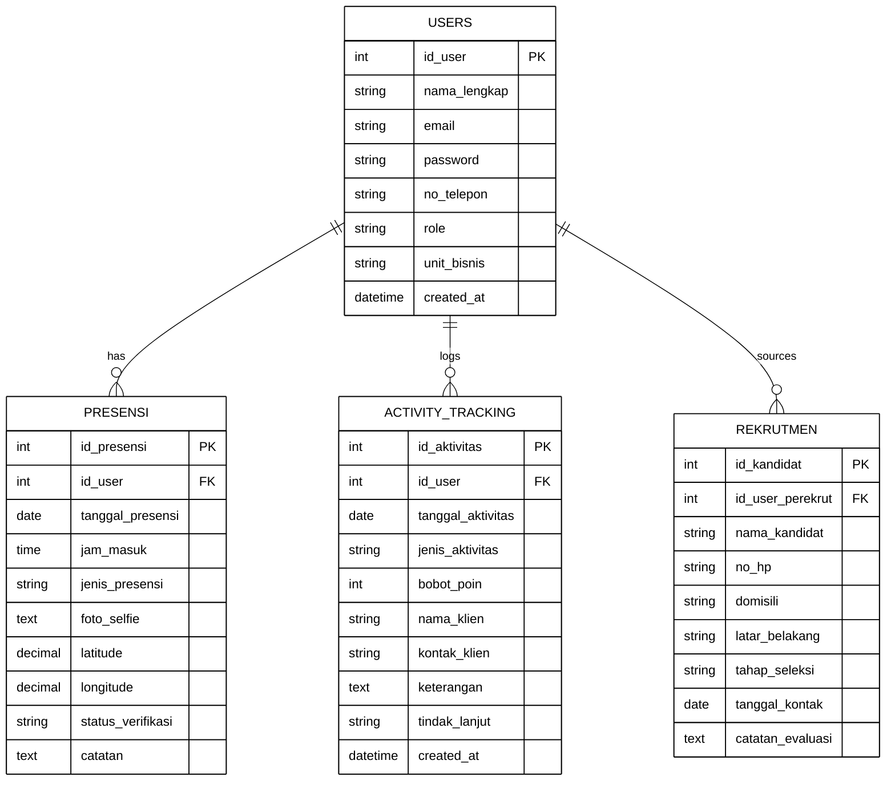

# KUMPULAN KODE MERMAID DIAGRAM UML BAB IV (STANDAR AKADEMIK PERSIS CONTOH DOSEN)
**Laporan PKL:** Perancangan Sistem Informasi Manajemen Presensi dan Monitoring Aktivitas Harian Agen (*Activity Tracking*) Berbasis Web pada GA *Office* Manulife LKG MW  
**Penulis:** Erdaniwati (Institut Teknologi dan Bisnis Indonesia / ITBI Medan)  
**Tema:** *Pure Monochrome* (Hitam Putih Murni - Standar Cetak Skripsi/PKL)  
**Kesesuaian Format:** Mengikuti alur, tata letak, dan sintaks persis sesuai berkas/gambar acuan dosen (*Swimlane* Berbingkai Tabel dengan Percabangan Validasi Berulang dan *Decision Diamond* "Ya" / "Tidak").

---

## 1. Gambar IV.1: Activity Diagram Sistem Berjalan (Format Swimlane 3 Kolom)
*Alur kerja manual pemrosesan presensi dan rekapitulasi poin aktivitas fisik. Format: Petugas / Pengirim (Agen) | Operator (Staf Administrasi) | Pimpinan (GA Owner)*

```mermaid
%%{init: {'theme': 'base', 'themeVariables': {
    'primaryColor': '#ffffff',
    'primaryTextColor': '#000000',
    'primaryBorderColor': '#000000',
    'lineColor': '#000000',
    'edgeLabelBackground':'#ffffff',
    'tertiaryColor': '#ffffff',
    'clusterBkg': '#ffffff',
    'clusterBorder': '#000000',
    'titleColor': '#000000'
}}}%%
flowchart TD
    subgraph Petugas ["<b>Petugas / Pengirim (Agen Pemasar)</b>"]
        startNode((●))
        P1["Menyerahkan formulir aktivitas mingguan"]
        P2["Melengkapi kekurangan catatan formulir"]
        P3["Menyerahkan kembali formulir aktivitas"]
    end

    subgraph Operator ["<b>Operator (Staf Administrasi)</b>"]
        O1["Menerima formulir aktivitas mingguan"]
        O2["Memeriksa kelengkapan formulir"]
        O3{"Formulir tidak lengkap?"}
        O4["Menginformasikan kekurangan formulir"]
        O5["Memeriksa kembali kelengkapan formulir"]
        O6["Mencatat data aktivitas agen"]
        O7["Menghitung akumulasi poin mingguan"]
        O8["Merekapitulasi dan memeriksa target 20 poin"]
        O9["Meneruskan laporan fisik kepada pimpinan"]
        O10["Mencatat disposisi pimpinan"]
        O11["Meneruskan hasil evaluasi kepada agen"]
        O12["Mengarsipkan dokumen laporan dan disposisi"]
        endNode(((●)))
    end

    subgraph Pimpinan ["<b>Pimpinan (Pimpinan Agensi / GA Owner)</b>"]
        L1["Menerima dan memeriksa laporan fisik"]
        L2["Mengevaluasi kinerja & membuat disposisi coaching"]
    end

    startNode --> P1
    P1 --> O1
    O1 --> O2
    O2 --> O3
    O3 -- Ya --> O4
    O4 --> P2
    P2 --> P3
    P3 --> O5
    O5 --> O3
    O3 -- Tidak --> O6
    O6 --> O7
    O7 --> O8
    O8 --> O9
    O9 --> L1
    L1 --> L2
    L2 --> O10
    O10 --> O11
    O11 --> O12
    O12 --> endNode

    style startNode fill:#000000,stroke:#000000
    style endNode fill:#ffffff,stroke:#000000,stroke-width:2px
    classDef act fill:#ffffff,stroke:#000000,stroke-width:1.2px,color:#000000;
    class P1,P2,P3,O1,O2,O4,O5,O6,O7,O8,O9,O10,O11,O12,L1,L2 act;
```

---

## 2. Gambar IV.2: Use Case Diagram Sistem yang Diusulkan (Hitam Putih)
*Menggambarkan batasan sistem web, 3 aktor pengguna, 10 use case fungsional, dan relasi include / extend*

```mermaid
%%{init: {'theme': 'base', 'themeVariables': {
    'primaryColor': '#ffffff',
    'primaryTextColor': '#000000',
    'primaryBorderColor': '#000000',
    'lineColor': '#000000',
    'edgeLabelBackground':'#ffffff',
    'tertiaryColor': '#ffffff',
    'clusterBkg': '#ffffff',
    'clusterBorder': '#000000',
    'titleColor': '#000000'
}}}%%
flowchart TD
    subgraph AktorAtas [" "]
        Agen["<b>Agen Pemasar</b><br>(Financial Consultant)"]
    end

    subgraph Boundary ["<b>Sistem Informasi Presensi & Activity Tracking (GA Office Manulife LKG MW)</b>"]
        direction TB
        UC1(["UC01: Otentikasi & Login Multi-Role"])
        UC2(["UC02: Presensi Geospasial & Selfie Webcam"])
        UC3(["UC03: Mencatat Aktivitas Harian Prospek"])
        UC4(["UC04: Memantau Capaian Poin & Warning Target"])
        UC5(["UC05: Mengelola Data Master Agen & Akun"])
        UC6(["UC06: Verifikasi & Monitoring Presensi Harian"])
        UC7(["UC07: Validasi & Rekapitulasi Data Aktivitas"])
        UC8(["UC08: Mencatat Data Kandidat Rekrutmen Agen"])
        UC9(["UC09: Mengakses Dasbor Kinerja & Analisis Agensi"])
        UC10(["UC10: Mencetak Rekapitulasi Laporan (PDF/Excel)"])
    end

    subgraph AktorBawah [" "]
        direction LR
        Admin["<b>Staf Administrasi</b><br>(Dwy & Tabita)"]
        Owner["<b>Pimpinan Agensi</b><br>(Kasteria Ginting)"]
    end

    Agen --- UC1
    Agen --- UC2
    Agen --- UC3
    Agen --- UC4
    Agen --- UC8

    Admin --- UC1
    Admin --- UC4
    Admin --- UC5
    Admin --- UC6
    Admin --- UC7
    Admin --- UC8
    Admin --- UC9
    Admin --- UC10

    Owner --- UC1
    Owner --- UC4
    Owner --- UC6
    Owner --- UC9
    Owner --- UC10

    UC2 -.->|&laquo;include&raquo;| UC1
    UC3 -.->|&laquo;include&raquo;| UC1
    UC6 -.->|&laquo;include&raquo;| UC1
    UC9 -.->|&laquo;include&raquo;| UC1
    UC3 -.->|&laquo;extend&raquo;| UC4

    classDef actorBox fill:#ffffff,stroke:#000000,stroke-width:2px,color:#000000;
    classDef ucBox fill:#ffffff,stroke:#000000,stroke-width:1.5px,color:#000000;
    class Agen,Admin,Owner actorBox;
    class UC1,UC2,UC3,UC4,UC5,UC6,UC7,UC8,UC9,UC10 ucBox;
```

---

## 3. Gambar IV.3: Activity Diagram Sistem Usulan - Presensi Geospasial & Webcam (Swimlane 2 Kolom)
*Alur presensi digital geospasial. Format persis gambar acuan dosen: Pengguna (Agen) | Sistem (Sistem Web Presensi)*

```mermaid
%%{init: {'theme': 'base', 'themeVariables': {
    'primaryColor': '#ffffff',
    'primaryTextColor': '#000000',
    'primaryBorderColor': '#000000',
    'lineColor': '#000000',
    'edgeLabelBackground':'#ffffff',
    'tertiaryColor': '#ffffff',
    'clusterBkg': '#ffffff',
    'clusterBorder': '#000000',
    'titleColor': '#000000'
}}}%%
flowchart TD
    subgraph Pengguna ["<b>Pengguna (Agen Pemasar)</b>"]
        startP((●))
        P1["Membuka menu Presensi Kehadiran"]
        P2["Memilih Tambah Presensi"]
        P3["Mengisi data status kehadiran (Kantor/Dinas)"]
        P4["Mengambil foto selfie dan koordinat GPS"]
        P5["Menekan tombol Kirim Presensi"]
        P6["Memperbaiki data atau foto"]
        P7["Menekan tombol Kirim Presensi"]
        P8["Melihat informasi riwayat presensi"]
        endP(((●)))
    end

    subgraph Sistem ["<b>Sistem (Sistem Web Presensi)</b>"]
        S1["Menerima permintaan tambah presensi"]
        S2["Memproses permintaan"]
        S3["Menyiapkan formulir dan sensor kamera/GPS"]
        S4["Menampilkan formulir dan live kamera"]
        S5["Menerima data presensi"]
        S6["Memvalidasi data dan foto selfie"]
        S7{"Data atau foto tidak valid?"}
        S8["Menampilkan pesan kesalahan"]
        S9["Menerima kembali data presensi"]
        S10["Memvalidasi ulang data dan foto"]
        S11["Menyimpan data presensi ke database"]
        S12["Menghasilkan riwayat presensi"]
        S13["Menetapkan status Terverifikasi"]
        S14["Menampilkan notifikasi presensi berhasil"]
    end

    startP --> P1
    P1 --> P2
    P2 --> S1
    S1 --> S2
    S2 --> S3
    S3 --> S4
    S4 --> P3
    P3 --> P4
    P4 --> P5
    P5 --> S5
    S5 --> S6
    S6 --> S7
    S7 -- Ya --> S8
    S8 --> P6
    P6 --> P7
    P7 --> S9
    S9 --> S10
    S10 --> S7
    S7 -- Tidak --> S11
    S11 --> S12
    S12 --> S13
    S13 --> S14
    S14 --> P8
    P8 --> endP

    style startP fill:#000000,stroke:#000000
    style endP fill:#ffffff,stroke:#000000,stroke-width:2px
    classDef act fill:#ffffff,stroke:#000000,stroke-width:1.2px,color:#000000;
    class P1,P2,P3,P4,P5,P6,P7,P8,S1,S2,S3,S4,S5,S6,S8,S9,S10,S11,S12,S13,S14 act;
```

---

## 4. Gambar IV.4: Activity Diagram Sistem Usulan - Activity Tracking & Warning Threshold (Swimlane 2 Kolom)
*Alur input aktivitas prospek harian dan kalkulasi batas target 20 poin. Format persis acuan dosen: Pengguna | Sistem*

```mermaid
%%{init: {'theme': 'base', 'themeVariables': {
    'primaryColor': '#ffffff',
    'primaryTextColor': '#000000',
    'primaryBorderColor': '#000000',
    'lineColor': '#000000',
    'edgeLabelBackground':'#ffffff',
    'tertiaryColor': '#ffffff',
    'clusterBkg': '#ffffff',
    'clusterBorder': '#000000',
    'titleColor': '#000000'
}}}%%
flowchart TD
    subgraph Pengguna ["<b>Pengguna (Agen Pemasar)</b>"]
        startA((●))
        A1["Membuka menu Activity Tracking"]
        A2["Memilih Tambah Aktivitas"]
        A3["Mengisi data calon nasabah dan kategori"]
        A4["Mengisi uraian interaksi dan tindak lanjut"]
        A5["Menekan tombol Simpan"]
        A6["Memperbaiki data isian aktivitas"]
        A7["Menekan tombol Simpan"]
        A8["Melihat informasi capaian poin dan status"]
        endA(((●)))
    end

    subgraph Sistem ["<b>Sistem (Sistem Web Activity Tracking)</b>"]
        W1["Menerima permintaan tambah aktivitas"]
        W2["Memproses permintaan"]
        W3["Menyiapkan formulir aktivitas prospek"]
        W4["Menampilkan formulir aktivitas prospek"]
        W5["Menerima data aktivitas"]
        W6["Memvalidasi data aktivitas"]
        W7{"Data aktivitas tidak valid?"}
        W8["Menampilkan pesan kesalahan"]
        W9["Menerima kembali data aktivitas"]
        W10["Memvalidasi ulang data aktivitas"]
        W11["Menyimpan data aktivitas ke database"]
        W12["Menghitung total akumulasi poin 7 hari"]
        W13["Menetapkan status Target / Warning"]
        W14["Menampilkan notifikasi aktivitas berhasil"]
    end

    startA --> A1
    A1 --> A2
    A2 --> W1
    W1 --> W2
    W2 --> W3
    W3 --> W4
    W4 --> A3
    A3 --> A4
    A4 --> A5
    A5 --> W5
    W5 --> W6
    W6 --> W7
    W7 -- Ya --> W8
    W8 --> A6
    A6 --> A7
    A7 --> W9
    W9 --> W10
    W10 --> W7
    W7 -- Tidak --> W11
    W11 --> W12
    W12 --> W13
    W13 --> W14
    W14 --> A8
    A8 --> endA

    style startA fill:#000000,stroke:#000000
    style endA fill:#ffffff,stroke:#000000,stroke-width:2px
    classDef act fill:#ffffff,stroke:#000000,stroke-width:1.2px,color:#000000;
    class A1,A2,A3,A4,A5,A6,A7,A8,W1,W2,W3,W4,W5,W6,W8,W9,W10,W11,W12,W13,W14 act;
```

---

## 5. Gambar IV.5: Sequence Diagram Presensi Geospasial & Webcam (Hitam Putih)
*Alur interaksi berurutan antara antarmuka, API sensor peramban, controller PHP, dan basis data MySQL*

---

## 6. Gambar IV.6: Sequence Diagram Activity Tracking & Warning Threshold (Hitam Putih)
*Alur kalkulasi skor bobot instan, kueri akumulasi rolling 7 hari kalender, dan evaluasi threshold*

---

## 7. Gambar IV.7: Class Diagram Sistem Informasi (Hitam Putih)
*Struktur kelas, spesifikasi atribut, metode pemrosesan, dan hubungan antarkelas*

---

## 8. Gambar IV.8: Entity Relationship Diagram / ERD (Hitam Putih)
*Relasi tabel basis data MySQL (users, presensi, activity_tracking, rekrutmen)*

